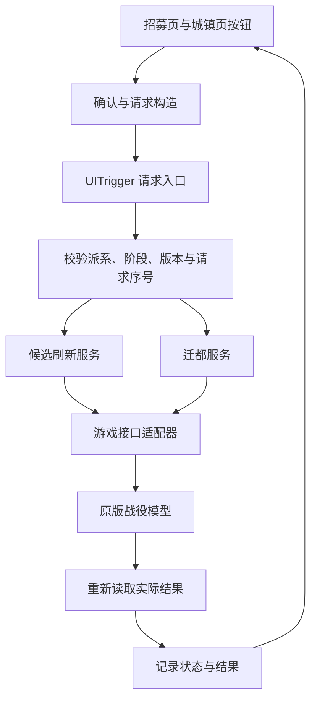

# 《全面战争：战锤 3》招募刷新与迁都 Mod 设计

版本：0.1。更新：2026-10-31。状态：精确冻结包离线完整玩家流程 L0–L3 已通过，实际证据与未测范围见验收报告。

本文以 [可行性预研](feasibility-study.md) 和 [研究证据清单](research-evidence-2026-10-30.json) 为依据。项目暂定名称“征募与迁都”，内部命名空间 `xatw3_campaign_utilities`。下文目录、组件 ID、数据结构和适配器方法属于待实现设计；只有明确列为原版接口的名称才代表已找到的游戏能力。

## 1. 目标和首版范围

交付一个可在启动器中启用的 `.pack`，提供两个相互独立的功能：

1. 普通领主和事务官招募页上的“刷新候选”按钮，立即替换当前类别内允许替换的人物。
2. 玩家城镇面板上的“迁都”按钮，将本派系首都迁至选定的自有城镇。

首版以本机 `9.0.4.0`、Build `25961564` 为验证基线，先支持单人超凡帝国。混沌魔域须单独通过同类验收后再列为支持。联机、序章、教程和特殊招募机制暂不启用；这属于本设计的分阶段假设，不能解释为用户取消了其他范围。

| 项目 | 默认设计 |
| --- | --- |
| 影响对象 | 当前玩家派系 |
| 刷新范围 | 当前选中的普通角色子类型，不刷新整个派系所有类别 |
| 刷新数量 | 替换本次确定可替换的旧候选数量，成功后该集合人数不变 |
| 刷新费用与回合冷却 | 0、无额外回合冷却；执行期间防止重复点击 |
| 迁都目标 | 实际拥有的常规城镇，省会与小城均可 |
| 迁都费用与回合冷却 | 0、无额外回合冷却 |
| 额外收益 | 不添加经济或战斗加成 |
| 语言 | 默认简体中文，保留英文文案源 |

按相同规则重复刷新允许再次随机到相同背景特性，不承诺必定刷出“更好”的特性。刷新同一子类型也不会改变其职业或魔法派系。

## 2. 玩家交互

### 2.1 招募刷新

玩家打开领主或事务官招募面板，选择一种普通子类型。在候选列表操作区显示“刷新候选”，悬停说明本次影响范围和受保护对象。

点击后显示确认框，例如：“替换当前火焰法师类别中的 2 名普通候选。已招募过和特殊人物将保留。费用：0。”确认前不修改候选池；确认后重新验证目标集合，再执行替换。

执行期间禁用同类操作。成功后刷新面板并保留当前类别与滚动位置；若引擎不能直接更新，则按 P-UI 验证过的方式重开招募面板。保留界面位置失败不应触发第二次候选替换。

| 状态 | 玩家看到的内容 |
| --- | --- |
| 有可替换普通候选 | 按钮可用，并显示确认范围 |
| 当前页是传奇、特殊招募或未适配类别 | 按钮禁用，说明该类别暂不支持刷新 |
| 全部候选受保护或身份未确认 | 按钮禁用，说明没有可安全替换的候选 |
| 列表在确认期间改变 | 提示列表已变化，重新检查；本次请求不执行 |
| 正在执行 | 按钮禁用，显示“正在刷新……” |
| 部分操作失败 | 明确显示已替换数量和未完成数量，停止自动续做 |

不把“特性值相同”当成刷新失败。新旧人物标识、候选集合和合法招募状态才是主要读回证据。

### 2.2 迁都

玩家选中自己控制的城镇，在城镇标题栏、重命名按钮附近看到“迁都”。确认框显示当前首都与目标城镇：“将首都由 A 迁至 B？不会改变建筑等级和省会位置。”

确认后在执行时重新检查所有权、实际城镇和当前首都。调用成功并读回后刷新首都相关显示，提示“首都已迁至 B”。不自动移动镜头、军队或人物。

| 条件 | 行为 |
| --- | --- |
| 自有、非当前首都的常规城镇 | 可确认迁都 |
| 目标已是首都 | 禁用，提示“当前首都” |
| 敌方、盟友或附庸城镇 | 不提供可执行操作 |
| 废墟、仅有地下设施/据点、非实际所有权 | 禁用，说明不满足城镇条件 |
| 目标正被围攻，或有战斗/过回合等阻塞状态 | 暂时禁用；这是首版保守规则，后续可依据实测调整 |
| 派系无常规首都，或处于未适配特殊机制 | 禁用并说明原因 |

新首都日后失守时由原版处理，不通过每回合监听强制迁回指定地点。

## 3. 总体结构



界面只提交意图；业务层负责重新查询、校验和修改。候选池读取、人物删除、界面重新绑定等依赖引擎的操作集中在适配器中，不散落到按钮监听函数。

原版 `CampaignUI.TriggerCampaignScriptEvent` 与 `UITrigger` 的语义见 [CampaignUI 文档](https://chadvandy.github.io/tw_modding_resources/WH3/campaign/campaignui.html#function:CampaignUI:TriggerCampaignScriptEvent)。首版仍限制为单人；采用该入口只是为隔离 UI 与模型，不代表已经解决联机同步。

### 3.1 拟定源码布局

```text
mod/
  script/campaign/mod/xatw3_campaign_utilities.lua
  script/campaign/xatw3_campaign_utilities/
    config.lua
    requests.lua
    state.lua
    adapters.lua
    recruitment.lua
    capital.lua
    ui.lua
  ui/xatw3_campaign_utilities/
    refresh_button.twui.xml
    capital_button.twui.xml
    confirm_dialog.twui.xml
localisation/
  zh-CN.tsv
  en.tsv
tools/
  <构建与静态检查入口，实施时确定>
tests/
  <过滤、请求去重和失败处理的离线用例>
docs/
  feasibility-study.md
  mod-design.md
  research-evidence-2026-10-30.json
```

构建时将一个语言源编译为包内 `text/db/xatw3_campaign_utilities.loc`。首版中文包使用中文源；英文包作为替代构建，不与中文包同时启用。不能把具有相同 key 的两套译文直接打入同一加载空间，导致覆盖顺序决定语言。

最终包使用常规 `mod` 类型，文件名小写。入口脚本的自动加载、模块加载路径和本机 Lua 语法能力在 P-UI 中验证，不根据开发机 Lua 版本推断。打包器需支持当前包格式及自有资源；构建结果重开检查清单。RPFM 版本差异见 [项目更新记录](https://github.com/Frodo45127/rpfm/blob/master/CHANGELOG.md)。

### 3.2 模块职责

| 模块 | 职责 |
| --- | --- |
| `config.lua` | 功能开关、支持模式、已验证子类型策略 |
| `requests.lua` | 请求格式、派系验证、序号去重和执行互斥 |
| `state.lua` | 存读档、履历、操作结果及版本迁移 |
| `adapters.lua` | 原版接口调用、候选查询和 UI 上下文解析 |
| `recruitment.lua` | 过滤、计划替换、逐项执行和结果核对 |
| `capital.lua` | 迁都资格、原版调用和实际首都读回 |
| `ui.lua` | 按钮创建、确认框、原因提示和结果展示 |

## 4. 招募刷新设计

### 4.1 候选身份与保护

候选使用 `family_member_cqi` 标识，派系和子类型使用稳定 key；不把显示名称、列表序号或短生命周期的 `character` 引用当成身份。调用前通过原版 `cm:get_family_member_by_cqi` 等已核查能力重新取得对象。

“可替换”要求同时证明：属于请求派系、属于请求子类型、当前仍在普通招募池、来源为允许刷新的一般随机候选、从未被招募或作为特殊奖励保留。仅仅“没有军队”“等级低”或“不在地图上”都不够。

永远排除本次无法证明可替换的人物，包括唯一/不朽人物、派系领袖、具有特殊起始身份的人物、受伤人物、已招募后解散的人物、存储/导入人物和训练或任务生成的人物。是否为普通候选由明确适配决定，不依赖一份猜测完整的传奇姓名黑名单。

入池事件的原版包装已确认存在，见证据 L03；但“入池”不自动证明“从未招募”。履历表要结合经过 P-R1 验证的事件和初始快照。旧档未知人物默认保护；完成观察后可以识别的新候选才进入可刷新集合。若连后续自然生成候选也无法可靠分类，该适配保持未支持，继续研究。

### 4.2 子类型策略

每个已支持的子类型需要记录原版 agent 类型、性别/姓名生成规则、外观来源、背景生成规则、招募解锁、费用和特殊资源条件。策略来源为本机实际数据库及原版生成流程，升级后复核。

首个实现样本选取普通定居派系的一个领主子类型和一个事务官子类型，再扩展帝国、震旦等常规类别。高精灵影响力档位、基斯里夫冰雪宫廷、史兰仪式、血裔、黑色方舟、商队/车队、特殊奖励和新增 Mod 子类型需要专门适配；不得借通用生成接口绕过它们。

若某个受保护类别与普通类别共享页面，刷新只作用于明确支持且当前选中的子类型。原生 UI 暂时只能确定大类而不能确定子类型时，禁用并记录缺口，不对所有子类型广播刷新。

### 4.3 替换流程

以下适配器名称为本项目拟定方法，尚未实现：`read_pool`、`classify_candidate`、`spawn_candidate`、`remove_candidate`、`verify_candidate`。

1. 建立当前子类型候选快照，保存可替换 ID、受保护 ID 与当前列表指纹。指纹由排序后的稳定 ID 和有关状态构成，不依赖 UI 显示顺序。
2. 展示确认框。确认请求携带目标子类型和快照标识，执行入口重新取得池快照；不一致则拒绝本次操作。
3. 检查该子类型已通过 P-R1/P-R2，且没有执行中或结果未明的操作；锁定该派系的 Mod 操作入口。
4. 按确定顺序逐个替换。每次先生成一个替代候选，读取其持久标识，验证姓名、背景、外观、类别及原生招募状态，再清除对应旧候选。
5. 清除后重新读取候选集合，确认旧 ID 消失、新 ID 存在、受保护集合不变。全部预定项通过后，才把操作标为成功。
6. 记录结果，释放执行锁，通知界面重新绑定候选。

“先生成后清除”是待验证的首选顺序，不是引擎事务保证。P-R2 必须证明临时超额不会触发其他候选自动淘汰；若无法保证，就不能采用该顺序，更不能为此修改全局容量参数或直接先清空整个列表。

**无数据库式回滚假设。** 若中途失败，记录已验证完成的配对和未完成项，立即停止后续清除。只在已经证明安全的情况下清理由本次创建、且仍未招募的孤立候选；清理失败或人物状态不明时保留记录并禁用继续操作，要求回到操作前存档。不得再删除其他旧人物来“凑人数”。

原版候选创建方法和角色查找形式见 [Episodic Scripting](https://chadvandy.github.io/tw_modding_resources/WH3/campaign/episodic_scripting.html#function:episodic_scripting:spawn_character_to_pool)。原版可提供创建和清除原语，但本流程的安全性尚未得到实机证明。

### 4.4 结果定义

刷新成功要求：计划中的每个旧候选已离池，对应新候选可正常招募；受保护人物及其他子类型不变；该操作没有让军队、已部署事务官或招募容量发生意外改变。

只添加了新人物、只移除了旧人物、只更新 UI、仅收到引擎回调，都不满足完成条件。

## 5. 迁都设计

### 5.1 执行前检查

确认派系是当前单人玩家，处于允许操作的战役阶段；目标地区存在、由该派系实际持有、有常规城镇；派系具有常规首都；目标不是当前首都，且不处于本设计暂禁的围攻等状态。

目标绑定地区 key，城镇名称仅用于展示。确认框打开后玩家切换城镇，不应把请求悄悄重定向到新选中的城镇；目标状态改变时拒绝原请求。

### 5.2 调用与读回

经校验后，将派系接口和地区接口传给原版 `cm:change_home_region_of_faction`。本机原版用例见证据 L04/L05。

执行后重新查询派系 `home_region`。读回为目标地区，才能记录迁都成功并更新城镇面板和首都标记。界面刷新路径由 P-UI/P-C1 确认，不能用重复调用迁都函数修复图标缓存。

同时核对所有权、城镇等级、省会身份未因本功能改变。对人物奖励生成、首都省份资源和距离型效果等联动，按实际使用这些机制的代表派系验证，不声称原版所有派生效果都会即时重算。

如果引擎模型暂时不能明确读回，则记录结果未明并禁用自动重试。若其他脚本将首都再次改走，显示当前实际首都并记录冲突，不逐帧或每回合重新覆盖它。

## 6. 请求、状态与存档

### 6.1 请求合同

请求版本为 `1`。概念字段如下，最终串行化实现需验证引擎允许的事件字符串长度：

| 字段 | 类型 | 说明 |
| --- | --- | --- |
| `version` | 整数 | 请求协议版本 |
| `action` | 枚举 | `refresh_candidates` / `move_capital` |
| `faction_key` | 字符串 | 执行派系，须与事件上下文和当前游戏状态交叉核对 |
| `request_sequence` | 正整数 | 存档内递增的请求序号 |
| `turn` | 整数 | 发起回合，用于拒绝过期请求 |
| `target_key` | 字符串 | 子类型 key 或地区 key |
| `expected_state` | 字符串 | 确认时的池快照标识或旧首都 key |

只接受固定动作和已验证 key，限制长度，拒绝未知字段/版本和无效数值。不执行请求内拼接的 Lua 代码。`context:faction_cqi()` 是上下文核对信息，不被当成联机授权或反作弊机制。

### 6.2 持久状态

通过原版 `cm:set_saved_value` / `cm:get_saved_value` 保存带命名空间的数据。存储 key 与字符/数值/表类型的具体编码在实施时按原版持久化能力确认。

| 状态 | 内容 |
| --- | --- |
| `schema_version` | 本 Mod 状态格式版本 |
| `next_request_sequence` | 请求序号来源 |
| `candidate_provenance` | 候选持久 ID、派系、类别、来源、是否曾招募及来源可信程度 |
| `last_operation` | 请求号、动作、状态、已完成配对及必要的未决人物 ID |
| `last_capital_change` | 上次实际观察到的迁都前后地区和回合，用于诊断 |

履历清理遵循实际人物生命周期：仍在池内、仍存活或仍有未决操作引用的记录不能按固定回合数随意删除；确认消失且无引用的记录可以回收，避免长期存档无限增长。

不缓存模型接口对象；读档后重新查找。载入时若上次操作未完成，先核对实际池和首都，将其标为中断或结果待核实，不自动重放删除和生成步骤。迁都状态只作历史，不作为必须恢复的目标首都。

### 6.3 执行状态

```text
READY -> CONFIRMING -> VALIDATING -> EXECUTING -> VERIFYING -> SUCCEEDED
                      |                         |
                      +-> REJECTED              +-> PARTIAL / UNKNOWN
```

取消确认、状态过期或前置校验失败均不修改游戏模型。`PARTIAL` 和 `UNKNOWN` 禁止自动重试；读回清楚前不接受冲突请求。界面重复创建、重复确认及重复 `UITrigger` 通过请求序号和执行状态去重。

## 7. 界面实现约束

使用自有组件 ID：`xatw3_refresh_candidates`、`xatw3_move_capital`、`xatw3_confirm_action`。通过原版 [Core UI 创建与事件接口](https://chadvandy.github.io/tw_modding_resources/WH3/campaign/core.html#function:core:get_or_create_component) 注入，避免复制整份原版 `character_panel` 或 `settlement_panel`。

招募定位候选为 `character_panel` 的列表操作区域；迁都定位候选为 `settlement_panel` 的 `button_rename` 附近。它们来自本机 XML，完整 Lua 路径和可重入注入时机必须由 P-UI 确认。

只在相应面板打开、目标变更、模式切换或操作完成时更新；不每帧扫描整个 UI 树。UI 重建后先按组件 ID 查找，再决定是否创建。组件失效时重新取得，不持有跨面板生命周期的引用。

确认框、提示和禁用原因使用本地化 key。缩放布局以原版锚点为基准，不写死一个分辨率的屏幕坐标。首版文本按钮优先，必要图标使用游戏已有资源或自有资源。

## 8. 兼容性和安装

运行时不覆盖自然候选停留周期、全局容量、原版派系首都数据或大型面板文件。类型识别同时要求引擎 `CcoAgentSubtypeRecord.AutoGenerate=true` 与实际池条目的普通职业 key；元数据未知、特殊职业、传奇与训练类型不支持。人物级履历保护独立执行，不能仅凭类型标记删除未知来源人物。第三方 Mod 的特殊事件约束仍须单独兼容验证。

对于同样改动候选池或自动迁都的 Mod，先做组合测试；不宣称普遍兼容。首次兼容范围按明确的版本、派系、战役和 Mod 组合记录。

刷新功能依赖公开源码的 [memreader Plus](https://github.com/PKozdra/memreader_plus)；不依赖 MCT。依赖由其作者单独发布，本项目不转载第三方人物修改 Mod 或 DLL。当前原生适配验证范围为 Windows x64 的 9.0.4。缺少依赖、函数签名不唯一、调用链变化或对象身份/容器结构不一致时，在生成候选前拒绝请求。禁用后迁都和已经创建的角色仍可能保存在存档中，不能承诺自动恢复初始状态。

## 9. 验收计划

下面为设计用例，实际逐项结果见 [验收报告](acceptance-report.md)。离线检查覆盖过滤、序号去重和失败状态等业务规则；实际引擎行为由游戏内验收确认。

| 编号 | 场景 | 验收标准 |
| --- | --- | --- |
| T01 | 新档打开两种招募页和城镇页 | 三类入口均出现，原版招募、重命名和城镇操作正常 |
| T02 | 重开、切页及不同 UI 缩放 | 无重复按钮、错位、旧引用或点击串页 |
| T03 | 普通领主当前子类型刷新 | 新旧 ID 完成对应替换，其他类别不变，新人物可正常招募 |
| T04 | 普通事务官当前子类型刷新 | 姓名、外观、背景、容量与费用正确，其他已部署人物不变 |
| T05 | 传奇、不朽、受伤、已解散及特殊候选混合 | 所有受保护人物身份和状态保持 |
| T06 | 旧档没有完整候选履历 | 未知身份保留并解释原因，不按等级或姓名猜测删除 |
| T07 | 连续刷新 10 次并正常过回合 | 数量不累积；没有持续的空白人物；自然淘汰继续工作 |
| T08 | 重复事件、快速点击、确认时切页 | 每个请求最多执行一次，旧快照请求不执行 |
| T09 | 创建、删除和读回各阶段失败注入 | 未执行后续误删，记录明确，结果未明时不自动重放 |
| T10 | 迁都到自有省会和小城 | 模型首都正确，城镇等级和省会身份不变 |
| T11 | 非自有、废墟、当前首都和阻塞目标 | 正确拒绝，无模型修改 |
| T12 | 迁都后存读档、结束回合和失去新首都 | 状态保存正常，失城后的原版处理正常 |
| T13 | 刷新后存读档，未决操作载入 | 候选保持正确；中断操作不被自动重放 |
| T14 | 特殊招募页面及不支持战役/联机 | 功能明确禁用，不绕过影响力、训练、仪式等条件 |
| T15 | 与一个候选修改 Mod、一个迁都 Mod 分别组合 | 如实记录通过或冲突，不依赖加载顺序隐瞒失败 |
| T16 | 旧档启用及测试档禁用后载入 | 记录保存的变化与实际限制，不虚报可无损卸载 |

验收记录必须包含机器标识、UTC 时间、游戏 EXE/包版本、Mod 包 SHA-256、存档基线、实际操作及前后模型状态。刷新保存新旧持久 ID；迁都保存前后地区 key；截图用于佐证可见交互，不能代替模型读回。

## 10. 实施顺序和完成定义

| 阶段 | 内容 | 退出条件 |
| --- | --- | --- |
| M0：原型 | P-UI、P-R1、P-R2、P-C1 | 明确候选安全替换是否成立，以及可运行的 UI 和迁都链 |
| M1：迁都 | 资格校验、确认、原版调用、读回及存档 | P-C1/P-C2 与 T10–T12 通过 |
| M2：招募刷新 | 常规领主与事务官适配、保护、替换及失败处理 | P-R1–P-R3 与刷新核心用例通过 |
| M3：整合 | 双功能同包、中文界面、范围说明、构建与组合检查 | 首版支持范围内适用用例通过，产物可复现 |

M0 若证明无法安全替换原生池内候选，需要更新预研结论和候选实现路线；不能以重掷特性、自然每回合刷新或只实现迁都来声称双功能需求完成。

整个 Mod 完成的标准是：首版约定范围内，领主和事务官刷新及玩家迁都均有可安装包和实际游戏验证；所有已知限制写入发布说明。各轮实际执行状态以验收报告和后续实验记录为准。

实施说明：当前源码将请求与核心业务规则集中在 `logic.lua`，游戏接口与存档集中在 `runtime.lua`，界面位于 `ui.lua`；入口保留在 `script/campaign/mod/`。确认框复用原版 `dialogue_box`，未复制原版 XML。第一批适配调整为基斯里夫波耶老爷 `wh3_main_ksl_boyar` 与牧首 `wh3_main_ksl_patriarch`，扩大范围须有相应原型结果。本机账号拥有《战锤 3》但不拥有《战锤 1》，原生界面将卡尔·弗兰兹战役标为“需要额外内容”，因此改用基础游戏可用的普通人物路径验收；冰雪宫廷训练类仍不启用。

2026-10-31 新路径：`native_pool.lua` 定位引擎自然淘汰候选的专用调用链，按身份找到候选的原生池槽位，调用原生清理、列表压实与尾部清理。Lua 不直接写对象字段或容器指针。移除后由业务层检查原生 CCO 池的 ID 和人数。领主、事务官各 3 人整批替换及各 10 次连续刷新已在隔离存档成功；菜单 key 与战役脚本名不同，兼容性判断使用 `main_warhammer`。

UI 生命周期必须先于模型修改处理：真实招募面板缓存旧候选上下文。一次实验在后台替换成功后查询仍打开面板的旧卡片姓名，触发 NULL 访问。新实现调用 `CampaignUI.ClosePanel` 和 `CloseCurrentHUDPanel()`，等待关闭动画完成、面板不可见后才提交请求；后台也拒绝在该面板打开时进行清理。完成后使用原生 HUD 按钮重开相应类别，再显示结果。禁止只隐藏组件后宣称上下文已经释放。该顺序已完成领主、事务官各 10 次真实按钮实验，最终冻结包还需冷启动验收。

2026-10-31 类型扩展：不再把普通刷新硬编码为两个基斯里夫子类型。首次选中类型或观察新候选时，从原生数据库读取自动生成标记，再从该派系实际候选池读取职业。职业限定为 `general/dignitary/wizard/champion/engineer/runesmith/spy`；没有元数据就拒绝。点击候选决定当前子类型，英雄职业页内的多个魔法派系不会被混为一次刷新。火焰与天堂法师共用 wizard 原生池的隔离实验已验证仅替换指定子类型。普通池上限保护调整为 100，允许已验证的四人混合池，仍为生成的临时新条目保留读回空间。
