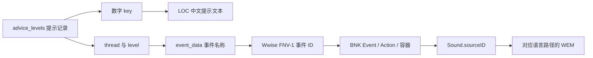

# 顾问音频提取、中文文案与换声机制

日期：2026-10-31。研究目录已迁移到 `mods/advisor_voice/`。本次完成资源解析、实际提取、中文文本关联和静态替换包验证，尚未进行游戏内换声验收。

## 已找到哪些中文文案

**当前通过顾问数据库定位出的 2,717 个媒体 ID，全部可以关联到游戏资源中的中文文案。** 它们对应 2,740 条提示记录。这是数据库键、事件命名及声音库引用形成的静态关联；尚未逐句试听确认，不能直接当成逐字转录认证。

范围扩大到本次选中的全部声音库后，共有 4,988 个媒体 ID，其中 3,394 个找到了中文候选文案，1,594 个仍未关联到中文。这个较大的集合还包含将领演说等额外资源，不能把 4,988 个全部称为顾问台词，也不能据此说未匹配的文件都没有中文。

本机已生成可直接查看的结果：

| 文件 | 内容 |
| --- | --- |
| `mods/advisor_voice/build/research-2026-10-31/texts/media-chinese-text.tsv` | 音频 ID、包内路径、简中、繁中、英文、文本键和关联依据 |
| 同目录 `media-texts.json` | 逐媒体的全部候选文本、来源、引用展开及缺口标记 |
| 同目录 `advice-texts.json` | 全部 2,969 条顾问记录的文本和已找到的音频 ID |
| 同目录 `subtitle-resources.json` | 六类相关文本资源，保留原文和展开后的文本 |
| 同目录 `summary.json` | 覆盖率、来源包指纹及范围限制 |

这些文件含游戏原始文案，保存在被 Git 忽略的 `build/`，没有随代码推送。音频原件保留在本机 `D:\workspace\.codex-wh3-runtime\advisor-audio-research\audit-en-a04\media\`，其中的相对路径与 TSV 的 `media_member` 一致。

### 中文文本来源

简体中文来自 `local_cn.pack:text/localisation__.loc`，完整解析出 212,411 个键；繁体中文包有 212,069 个键。英文来自 `local_en.pack` 的多个 LOC 文件，共 266,554 个键，顾问主体在 `text/db/advice_levels__.loc`，不能假定各语言使用同一个成员路径。

| 简中键族 | 资源条数 | 展开引用后含汉字的条数 |
| --- | ---: | ---: |
| `advice_levels_onscreen_text_` | 2,926 | 2,925 |
| `scripted_subtitles_localised_text_` | 1,250 | 1,249 |
| `aide_de_camp_speeches_text_` | 61 | 61 |
| `vo_speech_texts_text_` | 145 | 145 |
| `vo_fmv_texts_text_` | 92 | 92 |
| `pre_battle_speeches_text_` | 7 | 0 |

最后一类在当前包里是 `speech 1` 等占位文字，不能当成可朗读中文。旧式播报文字存在，也不代表都被当前声音系统使用。

顾问表共有 2,969 条记录：简中和繁中各找到 2,926 个对应键，英文找到全部 2,969 个。缺少中文键的 43 条中，26 条隐藏于 UI，17 条可见；其英文内容包含教程标记和弃用占位。它们均未通过当前命名规则定位到音频，不能认定是 43 段缺失的中文录音，更不能直接归因于缺 DLC。繁中没有补齐这 43 个键。

还处理了一个容易误判的真实例子：提示 `1180825077` 的原始中文值是 `{{tr:skaven_endgame_foreshadow_speech}}`，实际中文演说位于 `ui_text_replacements_localised_text_skaven_endgame_foreshadow_speech`，共 189 个字符。工具展开明确的 `{{tr:...}}` 引用，同时保留原始值、来源键和未解决引用；本次相关语料中每种语言各有一处这种引用，均已解决。

有 27 个媒体 ID 对应多个不同的中文候选文本，可能涉及重复记录、字幕和屏幕提示差异、同一事件的多段或随机音频。清单保留所有候选，不自动选一句作为逐字稿。批量生成新配音前，应先核对这些项目。

## 音频与文本如何关联



关键规则：

1. 提示表的数字 `key` 用于构造 `advice_levels_onscreen_text_<key>`，**不是** Wwise 事件 ID。当前全部 `audio_clip` 都是 `n`，也不能拿它当音频文件名。
2. `audio_base_bnk.pack:audio/wwise/event_data__core.dat` 提供 49,769 个普通事件名。工具规范化 `thread` 中的点、补上 `Play_`，再查找原名或附加数据库 `level` 的名字；本机 2,969 条记录的 level 均为 1。它是有证据可检查的命名关联，仍需运行时确认，不能随意删掉台词名末尾的数字。
3. 对实际存在的事件名执行小写 UTF-8 FNV-1，进入 BNK 的事件对象；随后沿 `ulActionID`、播放动作 `idExt`、容器 `ulChildID` 找到 `CAkSound.sourceID`。父级、总线、衰减器和 bank ID 都不作为播放子节点。
4. 根据媒体 ID 查找完整包内路径，例如 `audio/wwise/english(uk)/245716803.wem`。按实际语言目录选文件，再处理无语言的 SFX；不把同 ID 的英文候选自动认作中文运行时回退。
5. 剧情字幕和战斗播报还会使用其他文本键族。新增工具按事件名及有限的 `Play_`、末尾 `_1` 包装规则查找确切后缀，不做模糊匹配或自行翻译。一个事件可达多个媒体时，关联保留为候选组。

一个已解析样本：提示 `1001682303` → `Play_wh2_dlc13_camp_advice_lzd_warmblood_invaders_001_1` → 事件 ID `34042050` → 媒体 ID `245716803`。中文仍通过提示数字键定位；三种 ID 不可互换。

本次声音库版本为 `0x80000088`，WWiser 识别为 Wwise 136。HIRC 类型 14 是衰减器 `CAkAttenuation`，不能误当作对白事件。Stop 动作是控制动作，不会产生音频；未知对象、缺失节点、冲突对象和循环均单独记录。

## 实际提取与覆盖边界

从六个战役/战斗顾问声音库出发，另找到 `battle_vo_generals_speech__core.bnk` 和 `loading_screen_vo__core.bnk`。八个选中声音库经 WWiser 解析均无错误、无跳过；不同声音库间有 6 个对象 ID 的内容冲突，工具保留为未解决项，不任选一个。

| 项目 | 本机结果 |
| --- | ---: |
| 顾问数据库记录 | 2,969 |
| 找到命名事件的记录 | 2,748 |
| 有完整播放图并找到英文媒体的记录 | 2,740 |
| 尚未找到同名事件的记录 | 221 |
| 已命名但未解析出媒体的记录 | 8 |
| 顾问 DB 关联的不同媒体 ID | 2,717 |
| 六个顾问声音库事件可达的媒体 ID | 3,171 |
| 八个选中声音库全部 Sound 叶子媒体 ID | 4,988 |
| 实际提取的英文/SFX WEM | 4,988 |
| 实际提取字节 | 492,236,317 |

范围有重叠，后三种媒体计数不能相加。全部提取文件有 SHA-256，WEM 容器检查全部通过：4,864 个单声道、124 个双声道，均为 48 kHz、格式码 `0xffff`。使用官方 vgmstream r2168 对全部 4,988 个文件执行完整解码并丢弃 PCM，退出码全部为 0，stderr 全部为空。另实际导出了一个 2.127 秒的 WAV 样本。这验证了解码，没有进行试听或游戏播放。

当前仍有四条提示同时出现无后缀与 `_1` 事件候选；221 条未匹配记录中包含 91 条旁白记录。顾问声音库中也能找到采用 `Narrator_DLC29_CamFlyby_...` 等其他命名的事件，因此未匹配不等于媒体不存在。报告不把猜测的别名计入已完成覆盖。

工具仅读取明确列出的原版包，没有重建游戏及所有 Mod 的最终覆盖顺序。`audio_base_m.pack` 带加密数据标志和依赖，被当前有限解析器明确拒绝；它没有被当成已解析包。旧的 `advisor/wwise.dat` 文件名映射、外部源和影片音轨仍需另行审计。不能据此宣称“所有历史顾问、所有影片、全部 DLC 的全部配音已提取”。

### 中文语音与中文文案是两件事

本机 `audio_en.pack` 有 184,662 个成员，`audio_cn.pack` 只有 1,642 个；两种语言的 BNK 都有 648 个成员。中文声音库定义存在，不代表对应中文录音也存在。

在同一选中声音库范围中，英文/SFX 可找到全部 4,988 个媒体，中文/SFX 只能明确找到 1,649 个，覆盖 1,478 条顾问记录。其中 1,642 个来自中文包，另外 7 个是无语言 SFX。其余项目的英文变体仅列为候选，不把未经实机核对的语言回退规则写成事实。

**英文录音同样可以对应中文本地化文案。** 因此，“中文录音没有找到”不能推导为“中文文案没有找到”。本次 2,717 个 DB 关联媒体均获得中文文本候选，正是分别检查这两条链路的结果。

## 如何通过 Mod 换声

### 保留原事件，覆盖流式媒体

这是当前优先验证的路线：将新声音编码为游戏兼容的 Wwise WEM，沿用目标媒体的完整原始路径和数字文件名，放入独立的 type 3 Mod pack。提示、字幕、事件及声音库继续使用原版引用。共用媒体会同时影响所有引用者，专属台词需覆盖自己的媒体；实现单位是媒体引用，不是每个派系复制一整份顾问。

本次已生成一个本地原生音频互换探针：用 `1940057.wem` 的原生数据覆盖 `1015035.wem`，只包含 `audio/wwise/english(uk)/1015035.wem` 一个成员。两者均为流式 Vorbis、48 kHz、单声道。目标关联提示 `2051789675`，身份为 `standard_advisor`。

探针包 27,086 字节，SHA-256 为 `e132a1bbc5515a8ac76d8d0aebbf9b23bbef8736596338fce7fd3af4f0569b9b`；共用包读取器与独立文件索引读取器均回读到准确的替换字节。文件位于本机 `D:\workspace\.codex-wh3-runtime\advisor-audio-research\native-swap-a04\`。没有安装到游戏，没有把游戏原始音频提交到 Git，也未证明实际播放会采用该覆盖。

制作真正的新配音时，还需：

1. 按清单确认中文文本、说话身份、共用范围与多候选项；展开文本引用后再处理朗读标记和变量。
2. 录制或生成 WAV，控制时长、响度与声道。长段旁白、字幕时序和脚本队列尤其需要核对。
3. 编码成兼容的 Wwise Vorbis WEM。AssetEditor 源码提供 `WemVorbisEncoder.EncodeFromWavBytes`，是可进一步验证的编码路线；本次尚未运行该编码器。vgmstream 的解码成功不能代替编码验收，WAV 改扩展名也不构成 WEM 转码。
4. 按原媒体路径打包并在启动器启用；在主动离线状态下分别触发战役、战斗和剧情样本，检查加载顺序、实际换声、字幕和时序，随后扩大覆盖。

如果声音是嵌入声音库或带预取数据的流，单独覆盖外部 WEM 可能不足，需要同步处理声音库的媒体索引、数据及来源设置。`DIDX` 是嵌入媒体的 ID/偏移/长度索引，不是 DLC 信息。新建事件、替换影片音轨或修改多语言回退属于另外的实现路径，不能用本次单文件探针的成功回读代替验证。

缺 DLC 许可不妨碍读取已经安装的资源。本次没有检查账号拥有列表，也没有做购买前后的受控对比；缺失项应先检查语言、命名别名、隐藏/弃用条目、影片及最终加载包，不能先归因于 DLC。

## 可复现操作

需要 Python 3.14+（本机使用 3.15.1），以及 WWiser 源码。解析器通过显式目录导入，不需要安装进项目；本次固定源码提交为 `08e937b649bc7007c234bbd59e34a41d5eef3b38`。所有游戏资源导出必须位于外部目录或本 Mod 被忽略的 `build/`，工具拒绝写进游戏安装目录或受版本控制的源码目录。输出目录必须是新目录。

以下在仓库根目录执行，路径可按本机调整：

```powershell
$gameDir = 'C:\SteamLibrary\steamapps\common\Total War WARHAMMER III'
$runDir = 'D:\workspace\.codex-wh3-runtime\advisor-' + (Get-Date -Format yyyyMMdd-HHmmss)
$wwiserRoot = 'D:\workspace\.codex-wh3-runtime\advisor-audio-research\vendor\wwiser'
New-Item -ItemType Directory -Path $runDir
python ..\ck3_eternal_recurrence\tools\steam_offline_state_probe.py --timeout 5 --receipt "$runDir\offline.json"
python mods/advisor_voice/tools/catalog.py --mod advisor_voice --audio-language en --game-dir $gameDir --wwiser-root $wwiserRoot --steam-receipt "$runDir\offline.json" --output "$runDir\audio" --extract
python mods/advisor_voice/tools/text_catalog.py --mod advisor_voice --catalog "$runDir\audio\catalog.json" --steam-receipt "$runDir\offline.json" --output "$runDir\texts"
python mods/advisor_voice/tools/replacement_probe.py --mod advisor_voice --catalog "$runDir\audio\catalog.json" --target-media-id 1015035 --donor-media-id 1940057 --output "$runDir\probe"
python mods/advisor_voice/tests/run.py --mod advisor_voice
```

只做库存调查时不传 `--extract`。`--audio-language cn` 用于中文声音库/媒体调查；工具也接受其他已知语言标识，但本次只验过英文和中文。提取默认上限 512 MiB，覆盖更大范围时应先检查清单与存储空间，再显式调整。声音库解析和音频提取本身均不会启动游戏。

单个 WEM 转可听 WAV 的实际工具形式为：`vgmstream-cli.exe -i -o output.wav input.wem`。批量解码验证使用 `-i -O`，只解码并丢弃输出，不会播放声音。

## 验证与证据

- 47 个离线单元测试通过，覆盖 DAT、播放图、UTF-16 LOC、中文键关联、文本引用和 RIFF 边界。
- 原版数据库、事件名称和 LOC 均解析至 EOF；八个选中声音库零解析错误、零跳过；4,988 个 WEM 完整解码通过；替换探针经两个读取器回读校验。
- [机器可读证据](advisor-audio-extraction-evidence-2026-10-31.json)记录包指纹、统计、样本、工具版本、导出哈希及验证边界。
- [本地模型贡献记录](local-model-contributions-2026-10-31.json)记录 17 次真实请求、实际峰值并发 3、候选失败与最终采用范围。15 个完整结束、2 个截断丢弃；主执行者修正并验证候选，没有把 HTTP 成功当成业务验收。
- Steam 后台原生探针持续读回主动离线；未启动游戏、改变游戏原文件或发布创意工坊内容。

实现参考：[WWiser](https://github.com/bnnm/wwiser/tree/08e937b649bc7007c234bbd59e34a41d5eef3b38)、[AssetEditor DAT 解析器](https://github.com/donkeyProgramming/TheAssetEditor/blob/3ee43fc7460a8db8e64670d511f46060f3c436cc/Shared/GameFiles/Dat/DatFileParser.cs)、[AssetEditor WEM 编码器](https://github.com/donkeyProgramming/TheAssetEditor/blob/3ee43fc7460a8db8e64670d511f46060f3c436cc/Shared/GameFiles/Wwise/Wem/V132/Encoding/WemVorbisEncoder.cs)。音频解码使用 [vgmstream r2168 官方发布](https://github.com/vgmstream/vgmstream/releases/tag/r2168)，下载包核验官方 SHA-256；表结构参考 [RPFM WH3 schema](https://github.com/Frodo45127/rpfm-schemas/blob/master/schema_wh3.ron)，本次取得文件的哈希另载于证据。
