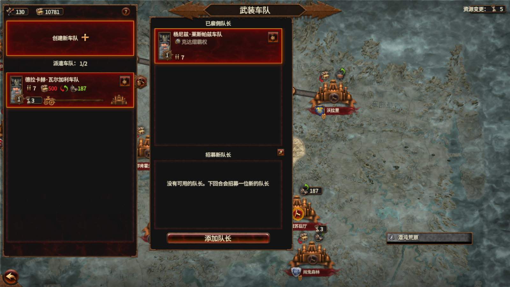

# 0.3.3 DLC 排查与实机验收

两处问题已修复，最终包通过单机实测及 197 项离线测试，尚未上传工坊。游戏为 9.0.5.0，Steam 测试全程主动离线；同期启用原样的迁都 0.2.0 包。

最终刷新包 SHA-256：`51af917201f2b82aac216783b3b5291ac8198671a444182c9f3a15b0cfbe73cd`。迁都包仍为 `e3702133d65dc7d08c1248a96e5b48a297505f238fe2d6e79a950d79f9d3767f`。

## 问题与修复

1. 混矮使用独立 `military_convoys/master_panel` 和 `button_convoys`，运输将领列表不经过普通人物招募页。0.3.2 虽接通后台候选处理，却没有这里的刷新按钮和关闭／恢复路径。0.3.3 将按钮放在“招募新队长”标题右侧，并在原生修改保护中加入此面板；关闭并释放上下文后刷新，再返回原列表。
2. 死亡系术士先知实际已由 2 名刷新到 3 名，界面却回到默认哈苏特系，造成“刷新无效”的观感。领主以 `wh_main_lore_death` 这样的法术系键作为标签，英雄页则可使用人物亚种键。现在关闭前保存当前可见、唯一选中的法术系标签及其容器，在分类重建后恢复原标签；不存在或不可见时不选择其他标签。

旧版车队入口缺失与中间候选包的领主法术系复现，分别留在[入口证据](acceptance-0.3.3/published-ui-gap.json)和[错误返回证据](acceptance-0.3.3/lord-lore-before-fix.json)。中间包的实测不计为最终包通过。

## 最终包实测

| 项目 | 结果 |
| --- | --- |
| 混矮原始运输将领雇用 | 成功扣费，原版背景对应护卫兵种及数量核对通过 |
| 双 Mod 共同启用迁都 | 乌兹库拉克迁到巨颅湖工厂；两处城镇建筑、等级、所有权和省会标志不变，候选池及已有车队不变，刷新请求序号不变 |
| 闲置车队保护 | 待雇用候选 1→1，身份和姓名不变、背景改变；已有闲置车队和其他招募池不变 |
| 迁都后派遣 | 通过原版界面派出车队，货物 500，在途状态正常 |
| 在途车队保护 | 再次 1→1，背景改变；在途车队的货物、单位和其他招募池保持 |
| 刷新后正常雇用 | 运输将领 1568 正常雇用、扣费，护卫兵种和数量匹配新背景 |
| 空车队候选池 | 不补员，不消耗请求序号，不改变已有车队 |
| 多法术系领主 | 死亡系 2→3，返回死亡系；其他法术系／英雄池、已拥有车队和替换候选的默认技能保持 |
| 新首都正常招募 | 死亡系术士先知正常雇用，军队数 +1、等级 1，实际出现在新工厂首都巨颅湖 |

离线测试为 90 项共用、107 项专属，包含独立车队关闭等待、按钮布局和领主法术系键恢复回归。构建可重现，包可往返解析，跟踪源码与验收包载荷相符。最终包从冷启动载入，未将生产源码热加载算作验收。

## 夹具与范围

迁都目标由夹具转让一处 NPC 城镇给玩家，不算攻城流程。先完成在途车队保护，再用原版 `wh3_dlc23_tech_chd_industry_22` 的瞬时研究夹具把车队容量由 1 提至 2，才进行刷新后雇用；原版容量为 1 且已有在途车队时，雇用按钮确实禁用。该夹具不算完整研究流程，Mod 自身不授予容量或解锁。

额外检查了 3 种商队面板与 85 条相关亚种元数据，其中 38 条不可自动生成的特殊记录继续排除。巴什瓦仍无授权，爪语者和巴什瓦运输将领未直接实测；其余新增 DLC 派系、有限招募家族未逐项原生验收。没有完整旅程返回、仪式／训练、刷新后存读档或联机实测信用。读取基线存档冷启动不等于验证刷新状态持久化。

测试包、依赖装载和用户脚本已清理，原始偏好逐字节恢复，Steam 普通客户端主动离线读回通过。项目指定的本地模型两次均未提供 `qwen38-coder`，未改用视频模型或旧地址；本次候选实现、审阅和验证由主执行完成。

完整[结构化报告](dlc-compatibility-20261118.json)、[验收门禁](acceptance-results-0.3.3.json)、[交叉核验](acceptance-0.3.3/verification.json)、[清理回执](acceptance-0.3.3/cleanup.json)与[近期 DLC 清单](../../../docs/dlc-activation-2026-11-18.md)。

